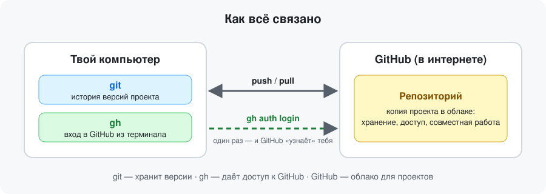
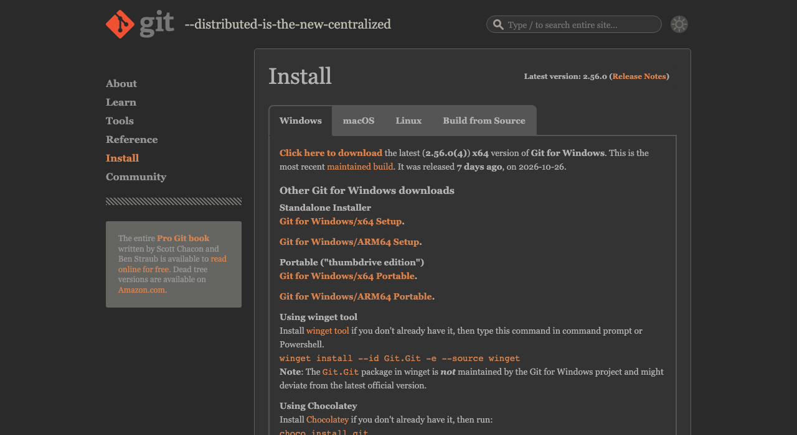
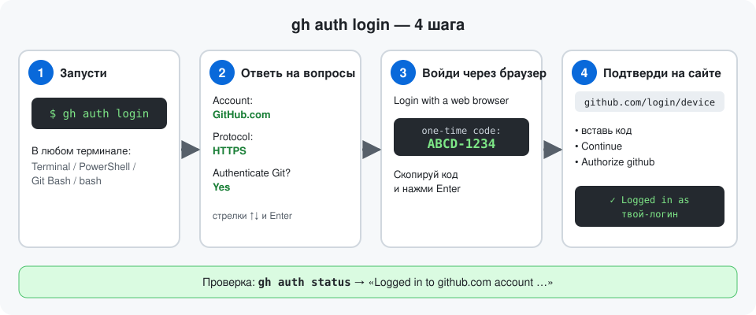

# Настройка git и gh для GitHub

> Ставим `git` и `gh`, представляемся git'у, входим в GitHub — один раз и на всех трёх системах: macOS, Windows, Ubuntu.

**Видео:** _ссылка после публикации_



- **git** — программа на компьютере, хранит историю версий проекта.
- **gh** — консольный клиент GitHub: логинит тебя и избавляет от паролей и токенов вручную.
- Нужен аккаунт на [github.com](https://github.com/signup).

## Шаг 1. Установка

Открой терминал: **macOS** — Terminal, **Windows** — PowerShell, **Ubuntu** — Terminal (`Ctrl+Alt+T`).

### macOS

Нужен [Homebrew](https://brew.sh) (установка — одна команда с главной страницы brew.sh).

```bash
brew install git gh
```

Только git, без Homebrew: `xcode-select --install`.


### Windows

Windows 10/11 с `winget` (встроен):

```powershell
winget install --id Git.Git -e --source winget
winget install --id GitHub.cli
```

После установки **закрой и заново открой PowerShell** — иначе команды не найдутся. Вместо winget можно скачать установщик на [git-scm.com](https://git-scm.com/install/windows) (все вопросы установщика — «Next»).



### Ubuntu

```bash
sudo apt update && sudo apt install git -y
```

`gh` ставим из официального репозитория GitHub (команда с [cli.github.com](https://github.com/cli/cli/blob/trunk/docs/install_linux.md#debian)):

```bash
(type -p wget >/dev/null || (sudo apt update && sudo apt install wget -y)) \
	&& sudo mkdir -p -m 755 /etc/apt/keyrings \
	&& out=$(mktemp) && wget -nv -O$out https://cli.github.com/packages/githubcli-archive-keyring.gpg \
	&& cat $out | sudo tee /etc/apt/keyrings/githubcli-archive-keyring.gpg > /dev/null \
	&& sudo chmod go+r /etc/apt/keyrings/githubcli-archive-keyring.gpg \
	&& sudo mkdir -p -m 755 /etc/apt/sources.list.d \
	&& echo "deb [arch=$(dpkg --print-architecture) signed-by=/etc/apt/keyrings/githubcli-archive-keyring.gpg] https://cli.github.com/packages stable main" | sudo tee /etc/apt/sources.list.d/github-cli.list > /dev/null \
	&& sudo apt update \
	&& sudo apt install gh -y
```


### Проверка (везде одинаково)

```bash
git --version
gh --version
```

Обе команды печатают версию — значит, установлено.

## Шаг 2. Представься git'у

Имя и e-mail попадут в каждый твой коммит. Одинаково на всех системах:

```bash
git config --global user.name "Имя Фамилия"
git config --global user.email "ты@example.com"
git config --global init.defaultBranch main
```

> Не хочешь светить почту — возьми адрес вида `ID+логин@users.noreply.github.com` в [Settings → Emails](https://github.com/settings/emails).

Проверка: `git config --global --list`

## Шаг 3. Вход в GitHub через gh

```bash
gh auth login
```



1. **GitHub.com** → **HTTPS** → **Authenticate Git with your GitHub credentials? — Yes**.
2. **Login with a web browser** → скопируй одноразовый код → Enter.
3. В браузере открой `github.com/login/device`, вставь код, подтверди **Authorize**.

Вопрос про Yes — важный: `gh` сам настроит git на вход в GitHub, пароли вводить не придётся.

## Шаг 4. Проверка

```bash
gh auth status
```

Должно быть `Logged in to github.com account <твой-логин>`. Пробный клон любого публичного репозитория:

```bash
gh repo clone cli/cli -- --depth 1
```

Скачалась папка `cli` — всё работает.

## Если что-то пошло не так

| Симптом | Что делать |
|---|---|
| `git: command not found` / `gh не распознано` | Закрой и снова открой терминал. На Windows — перезапусти PowerShell. |
| macOS просит «Install command line developer tools» | Нажми **Install**, дождись окончания и повтори команду. |
| Ubuntu: ошибка подписи `NO_PUBKEY` / `EXPKEYSIG` у `cli.github.com` | Повтори блок установки `gh` — он скачивает актуальный ключ. Подробности: [cli/cli#13118](https://github.com/cli/cli/issues/13118). |
| `gh auth login` пишет, что код неверный | Код живёт ~15 минут: запусти `gh auth login` заново. |
| Выйти из GitHub | `gh auth logout` |
